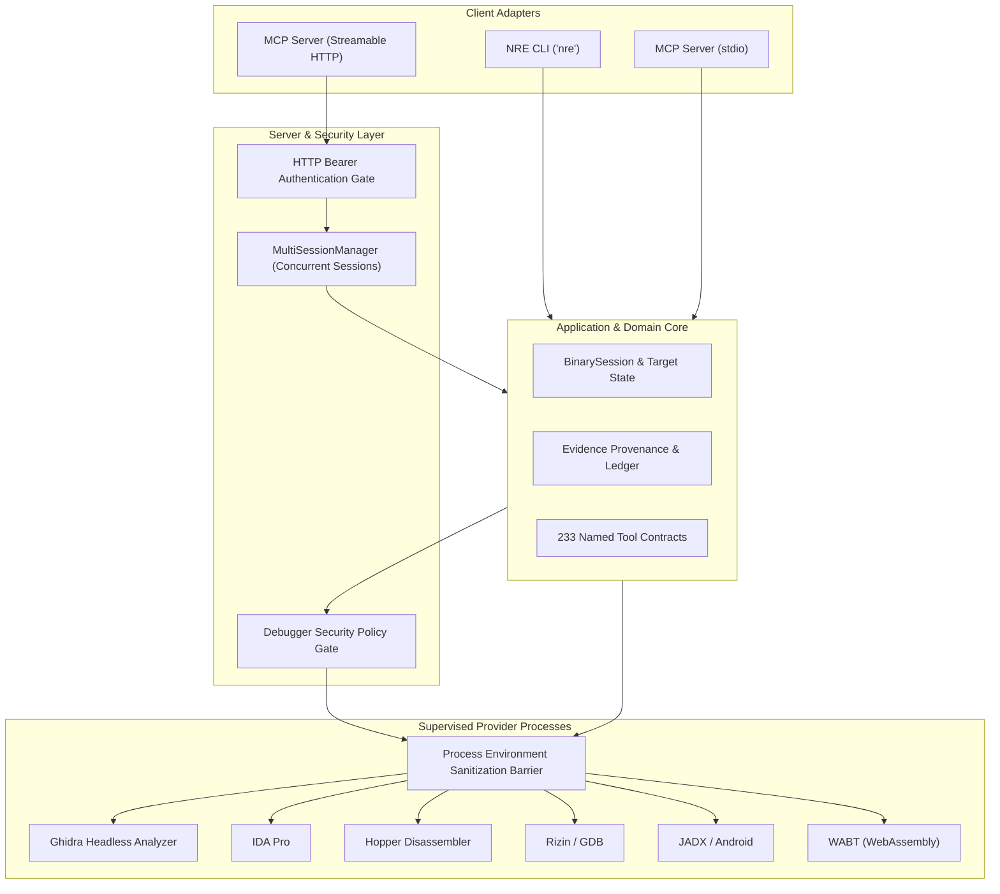

<div align="center">

# NRE: Nano Reverse Engineer

### Universal, AI-Native Reverse Engineering & Binary Intelligence Platform

**Inspect, decompile, trace, and reconstruct any software target—from native binaries to web applications and mobile packages.**

[](LICENSE)
[](https://www.npmjs.com/package/nano-reverse-engineer)
[](docs/mcp-contracts.md)
[](package.json)

[Overview](#overview) · [Core Capabilities](#core-capabilities) · [Supported Targets](#supported-analysis-targets) · [Architecture](#architecture-overview) · [Quick Start](#quick-start) · [CLI Usage](#cli-usage) · [MCP Integration](#mcp-integration) · [Configuration](#configuration) · [Security Model](#security-model) · [Roadmap](#project-roadmap)

```bash
npx nano-reverse-engineer setup
```

</div>

---

## Overview

**Nano Reverse Engineer (NRE)** is a local-first, universal reverse-engineering, software intelligence, and application reconstruction platform. It unifies static decompilation, symbolic disassembly, dynamic instrumentation, memory inspection, and network protocol analysis into a coherent interface accessible via terminal CLI and Model Context Protocol (MCP) servers.

Whether you are an independent security auditor, a reverse engineer analyzing zero-day threats, or an AI coding agent reconstructing undocumented proprietary formats, NRE provides verifiable **Evidence-based provenance** for every finding, structure, and reconstructed function.

---

## Core Capabilities

1. **Deep Binary Reverse Engineering:**
   - Multi-format disassembly & decompilation: PE/COFF (Windows), ELF (Linux/Android), Mach-O (macOS/iOS), raw firmware, and DOS COM/MZ.
   - Comprehensive CPU architecture coverage: x86, x86_64, ARM, AArch64, MIPS, PowerPC, RISC-V, M68k, SPARC, and WebAssembly.
   - Integrated headless provider orchestration: Ghidra, IDA Pro, Hopper Disassembler, Rizin, and Cutter.
2. **Mobile & Managed Runtime Decompilation:**
   - Android APK/AAB deconstruction, JADX Java decompilation, manifest extraction, permission graphs, and APK signature validation.
   - .NET / CIL assembly analysis, ILSpy deconstruction, and NativeAOT binary symbol recovery.
   - Python bytecode disassembly (`.pyc`) and PyInstaller single-file bundle extraction.
   - WebAssembly (`.wasm`) to WAT text translation and interface type extraction.
   - EVM bytecode disassembly and contract deconstruction via EVMole.
3. **Web & Electron Application Reconstruction:**
   - Complete JavaScript & TypeScript bundle unpackaging, AST traversal, and source map reconstruction.
   - Electron ASAR archive extraction, integrity verification, and fuse inspection.
   - Runtime inspection and Chrome DevTools Protocol (CDP) session interception.
4. **Dynamic Debugging & Instrumentation:**
   - Interactive GDB and Rizin debugging sessions with registers, breakpoints, call-stack backtraces, and memory dumping.
   - Frida dynamic instrumentation for live function hooking and parameter tracing.
   - Crash recording analysis: Linux core dumps, Windows minidumps, Apple IPS crash reports.
5. **Network Protocol & Traffic Intelligence:**
   - Deep PCAP / PCAPNG packet inspection with protocol dissection (DNS, TLS, HTTP/2, QUIC/HTTP3).
   - HTTP Archive (HAR) analysis, API endpoint discovery, and payload correlation.

---

## Supported Analysis Targets

| Domain                  | Supported Formats & Targets                                                                                |
| :---------------------- | :--------------------------------------------------------------------------------------------------------- |
| **Native Executables**  | Windows PE (`.exe`, `.dll`, `.sys`), Linux ELF, macOS Mach-O, `.dylib`, universal fat binaries, DOS MZ/COM |
| **Mobile Applications** | Android `.apk`, `.aab`, DEX bytecode, iOS App Bundles, Apple IPS crash reports                             |
| **Managed & Bytecode**  | .NET assemblies (`.dll`), Python bytecode (`.pyc`, PyInstaller), WebAssembly (`.wasm`), EVM bytecode, BEAM |
| **Desktop & Web**       | Electron ASAR archives, packaged Node.js single executable applications (SEA), minified JS/TS bundles      |
| **Firmware & Embedded** | Binwalk unpacked images, U-Boot uImage, FIT images, DeviceTree blobs (`.dtb`), ESP32 images                |
| **Network & Packets**   | PCAP, PCAPNG, HAR, SAZ, QLOG                                                                               |
| **Databases & Stores**  | SQLite database schemas, records, WAL journals                                                             |

---

## Architecture Overview

Dependencies in NRE flow strictly inward to preserve isolation, verifiable Evidence provenance, and reproducible analysis:



---

## Installation & Prerequisites

### Prerequisites

- **Node.js:** Node.js `>= 22.0.0` (LTS recommended)
- **External Tools (Optional by Provider):**
  - Ghidra (`>= 11.0`) with JDK 21+ for deep native decompilation.
  - IDA Pro (`>= 8.0`) or Hopper Disassembler for native disassembly.
  - JADX for Android APK deconstruction.
  - GDB or Rizin for interactive debugging.

### Global Installation via NPM

```bash
npx -y nano-reverse-engineer@latest analyze-javascript-application /absolute/path/to/app --json
```

### Global Installation via NPM

```bash
npm install --global nano-reverse-engineer
nre --help
```

### Keeping NRE Updated

```bash
nre update
```

Or run setup via npx:

```bash
npx nano-reverse-engineer@latest setup
```

```bash
nre update
```

```bash
npx nano-reverse-engineer@latest setup
```

---

## Quick Start

### 1. Analyze an Executable Target

```sh
# Perform automated binary diagnosis and target identification
nre analyze ./sample.exe

# Decompile a specific function by symbol or virtual address
nre decomp ./sample.exe --function main --provider auto

# Generate a structured JSON report
nre analyze ./firmware.bin --format json --output report.json
```

### 2. Launch Interactive MCP Server

```sh
# stdio transport (for Claude Desktop, Cursor, Antigravity)
nre mcp

# Streamable HTTP transport with authentication
nre mcp --http --port 8080 --token my-secret-auth-token
```

---

## MCP Integration

NRE exports **233 specialized reverse engineering tools** adhering strictly to the Model Context Protocol (MCP) standard.

### Claude Desktop / Cursor / Antigravity Configuration

Add NRE to your `mcpServers` configuration file:

```json
{
  "mcpServers": {
    "nre": {
      "command": "npx",
      "args": ["-y", "nano-reverse-engineer@latest", "mcp"]
    }
  }
}
```

### Remote Authenticated HTTP MCP Server

```json
{
  "mcpServers": {
    "nre-remote": {
      "url": "http://10.0.0.10:8080/mcp",
      "headers": {
        "Authorization": "Bearer your-secure-token"
      }
    }
  }
}
```

---

## Configuration & Environment Variables

NRE configuration can be declared in `nre.json` or provided via `NRE_*` environment variables.

| Environment Variable            | Default  | Description                                                     |
| :------------------------------ | :------- | :-------------------------------------------------------------- |
| `NRE_ANALYSIS_PROVIDER`         | `auto`   | Engine selector: `auto`, `ghidra`, `ida`, `hopper`, `kuna`      |
| `NRE_LOG_LEVEL`                 | `info`   | Logging verbosity: `debug`, `info`, `warn`, `error`             |
| `NRE_MCP_TOOL_FAMILIES`         | _(all)_  | Tool filtering: `analysis`, `debug`, `network`, `web`, `mobile` |
| `NRE_HTTP_AUTH_TOKEN`           | _(none)_ | Secret token required for HTTP MCP connections                  |
| `NRE_ALLOW_UNAUTHENTICATED`     | `false`  | Explicit opt-in for unauthenticated non-loopback HTTP binds     |
| `NRE_MCP_MAX_SESSIONS`          | `10`     | Maximum concurrent HTTP sessions in multi-tenant mode           |
| `NRE_ALLOW_UNSAFE_DEBUGGING`    | `false`  | Allow OS shell breakouts in GDB/Rizin (sandboxed lab use only)  |
| `NRE_GHIDRA_INSTALL_DIR`        | _(auto)_ | Absolute path to Ghidra installation root                       |
| `NRE_GHIDRA_STARTUP_TIMEOUT_MS` | `60000`  | Timeout for headless Ghidra initialization                      |

---

## Security Model

NRE operates with a strict, defense-in-depth security model:

1. **Network Authentication:** Non-loopback HTTP MCP endpoints fail closed unless an explicit bearer token is supplied. Constant-time verification prevents side-channel analysis.
2. **Debugger Sandbox Protection:** Debugger interfaces (GDB, Rizin) disallow arbitrary OS shell escapes (`shell`, `!`, `python subprocess`) by default.
3. **Environment Sanitization:** External child processes spawned for analysis (Ghidra, Python, WABT) have ambient secrets, AWS credentials, and API tokens scrubbed from their environment.
4. **Path Confinement:** Prevents directory traversal (`..`) and NUL byte injection when reading target files.

---

## Development & Testing

```sh
# Install locked dependencies
npm ci

# Run TypeScript typecheck across all 2,275 source files
node scripts/run-typescript.mjs --noEmit

# Run architectural invariant guards
node scripts/verify/architecture-guards.mjs

# Verify test discovery across all 2,870 test suites
node scripts/verify-test-discovery.mjs

# Execute targeted test suites
npm run test:fast
```

---

## Project Roadmap

- **v7.1:** High-performance binary indexing & content-addressed persistent caching.
- **v7.2:** Distributed analysis worker pools with strict memory sandboxing.
- **v7.5:** AgentEnv 2.0 full-stack microservice reconstruction & machine learning type recovery.
- **v8.0:** Zero-trust role-based tool access control & air-gapped sovereign deployment packaging.

---

## License

This project is licensed under the **Apache License, Version 2.0**. See the [LICENSE](LICENSE) file for details.

Copyright (c) 2026 Nano Reverse Engineer Contributors.
