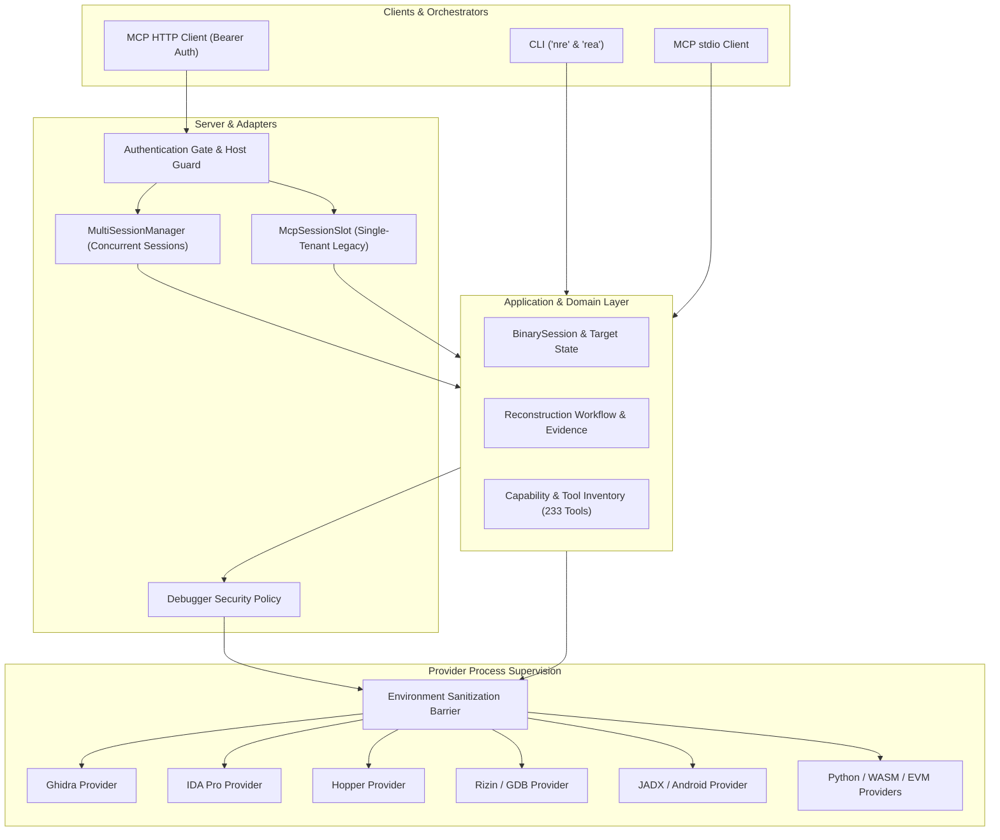

# NRE v7.0 Architecture Evolution & Technology Roadmap

## Current State Architecture (v7.0 Baseline)

With the v7.0 engineering upgrade, Nano Reverse Engineer has established a robust, security-hardened, and multi-tenant foundation:

---

## Strategic Technology Roadmap (v7.1 - v8.0)

### Phase 1: High-Performance Binary Indexing & Analysis Caching (v7.1)
- **Persistent Binary Evidence Cache:** Replace ephemeral-only session caches with content-addressed SQLite/RocksDB stores keyed by SHA-256 target digests.
- **Decompilation Memoization:** Avoid re-running expensive Ghidra decompiler passes on unmodified functions across consecutive sessions.
- **Incremental Symbol Resolution:** Stream cross-references and function calls on demand to minimize peak memory consumption for large (>500MB) binaries.

### Phase 2: Distributed Analysis Worker Pool (v7.2)
- **Worker Process Decoupling:** Decouple heavy provider executions (Ghidra Java runtime, Unblob, LLVM passes) into background worker pools with strict resource ceilings (`prlimit`).
- **Parallel Target Deconstruction:** Analyze multiple modules in a complex desktop application (e.g. Electron ASAR, native `.node` modules, and backend libraries) in parallel.
- **Remote Headless Ghidra Cluster:** Provide an optional remote Ghidra analyzer bridge for teams analyzing hundreds of binaries concurrently.

### Phase 3: AI-Native Reconstruction Pipeline (v7.5)
- **Agent Environment (AgentEnv) 2.0:** Extend dynamic browser capture and web application reconstruction to support full-stack microservice environments.
- **Automated Type & Struct Reconstruction:** Machine learning-guided type recovery for stripped C/C++ binaries, synthesizing compilable header files (`.h`) from decompiled ASTs.
- **Cross-Architecture Binary Diffing:** Deep neural embeddings for basic blocks to match obfuscated or differently compiled functions across x86_64, ARM64, and RISC-V.

### Phase 4: NRE Enterprise & Sovereign Security Platform (v8.0)
- **Zero-Trust Role-Based Access Control (RBAC):** Fine-grained MCP tool authorization where specific agent identities can be granted read-only analysis while disallowing memory-modifying debugging tools.
- **Air-Gapped / Isolated Appliance Packaging:** Pre-built container images and static bundles with offline symbol databases, Ghidra runtimes, and local LLM connectors for sovereign intelligence environments.
- **Formal Verification Integration:** Integration with SMT solvers (Z3) for automated exploit verification, path reachability proving, and patch analysis.

